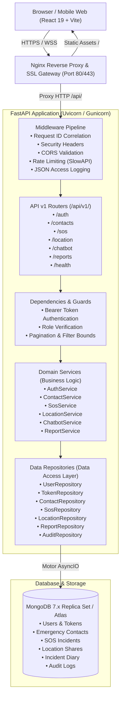
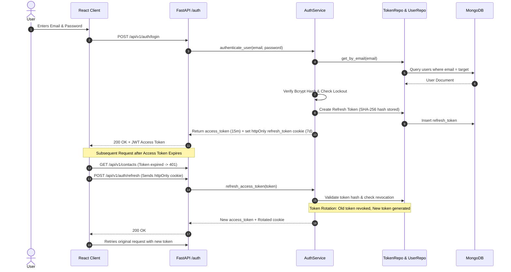
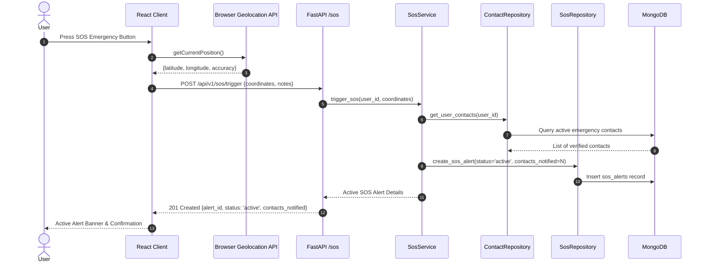

# SAKHISAHAY: System Architecture & Technical Specification

## 1. Executive Summary & Mission

**SAKHISAHAY** is a mission-critical full-stack digital platform designed to provide women with rapid emergency assistance, trusted contact coordination, live GPS location sharing, verified legal and emergency guidance, and confidential incident documentation.

The architecture emphasizes:
1. **Zero Downtime & Fast Response:** Sub-100ms API response latency for critical SOS and emergency contact lookups.
2. **Defensive Security & Privacy:** Strict zero-trust authentication, cryptographic token rotation, account lockout defense, and data segregation.
3. **Layered Separation of Concerns:** Rigid architectural boundaries ensuring testability, maintainability, and clean code hygiene.

---

## 2. Target Architecture Diagram



---

## 3. Layered Design & Architectural Rules

The backend strictly enforces a four-tier architecture. No layer is permitted to bypass another:

```
[ HTTP Endpoints / Routers ]
            │
            ▼
[ Domain Services (Business Logic) ]
            │
            ▼
[ Data Repositories (Database Access) ]
            │
            ▼
[ MongoDB Database (Motor Driver) ]
```

### 3.1 HTTP Endpoints / Routers (`backend/app/api/v1/endpoints/`)
- Sole responsibility: Parse HTTP requests, validate input via Pydantic schemas, invoke dependencies, call domain services, and return normalized responses with appropriate HTTP status codes.
- Prohibitions: No direct database access; no business calculation logic.

### 3.2 Domain Services (`backend/app/services/`)
- Sole responsibility: Implement business rules, enforce domain limits (e.g., maximum 10 emergency contacts per account, duplicate contact rejection, account lockout thresholds, multilingual keyword classification).
- Prohibitions: No HTTP request/response handling (headers, cookies, status codes are abstracted); no raw database queries.

### 3.3 Data Repositories (`backend/app/repositories/`)
- Sole responsibility: Encapsulate all database queries, projections, aggregations, and BSON/ObjectId transformations.
- Provides standard CRUD primitives (`get_by_id`, `find_one`, `find_many`, `create`, `update`, `delete`, `count`).

### 3.4 Schemas & Document Models (`backend/app/schemas/` & `backend/app/models/`)
- Strict Pydantic v2 models validate data ingress and egress.
- MongoDB internal `_id` is always mapped to clean string `id`. Sensitive attributes (`password_hash`, `token_hash`) are excluded by design from response schemas.

---

## 4. Key End-to-End Interaction Flows

### 4.1 Authentication & Silent Token Rotation



### 4.2 Emergency SOS Trigger Flow



---

## 5. Technology Stack Summary

| Component | Technology | Version | Purpose |
| :--- | :--- | :--- | :--- |
| **Frontend Framework** | React | 19.x | Declarative UI components and state management |
| **Frontend Tooling** | Vite | 8.x | High-performance bundling and development server |
| **Backend Framework** | FastAPI | 0.115.x | High-throughput asynchronous REST API framework |
| **Async Web Server** | Uvicorn / Gunicorn | Latest | ASGI server running multiple worker processes |
| **Database Driver** | Motor / PyMongo | 3.6.x / 4.9.x | Asynchronous non-blocking MongoDB client |
| **Data Validation** | Pydantic v2 | 2.10.x | Type checking, request parsing, and schema generation |
| **Cryptography** | Passlib / Bcrypt / PyJWT | 1.7.x / 4.2.x / 2.10.x | Password hashing and signed JWT authentication |
| **Rate Limiter** | SlowAPI | 0.1.9 | IP and user based request throttling |
| **Reverse Proxy** | Nginx | 1.27 Alpine | TLS termination, rate limiting, and static file delivery |
| **Database** | MongoDB | 7.0 | Document store for users, alerts, contacts, and reports |
